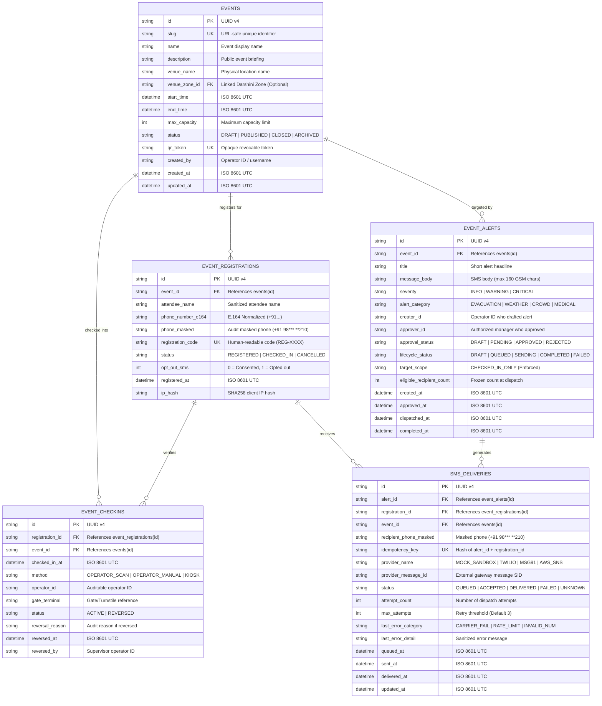
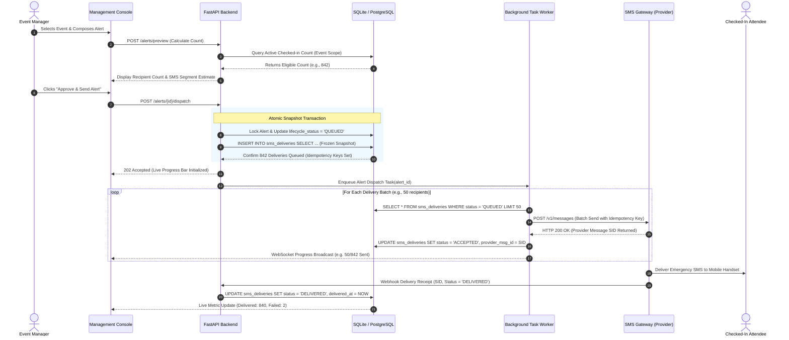
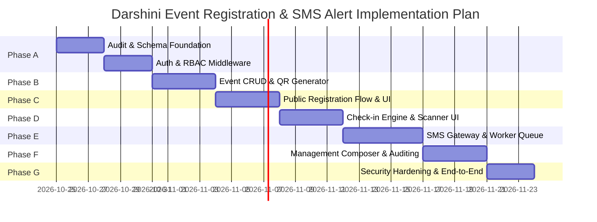

# Darshini — Event Registration, QR Check-in & Targeted SMS Alert System
## Phase 0: Read-Only Code Audit and Architecture Plan

**Document Version:** 1.0.0-final  
**Status:** Approved Architecture Specification (Phase 0 Complete)  
**Deliverable Path:** `docs/EVENT_REGISTRATION_SMS_ARCHITECTURE_PLAN.md`  
**Execution Mode:** STRICT READ-ONLY AUDIT (Zero application code or Git state modified)  

---

## 1. Executive Summary

Darshini is an operational command-and-control decision-support platform designed for venue crowd safety, perimeter monitoring, digital-twin flow simulation, and emergency routing. This document establishes the Phase 0 architecture plan to introduce **Event Registration, QR Check-in, and Event-Scoped Emergency SMS Notifications** into the Darshini ecosystem.

### Core Problem & Design Invariant
In dense public venues, broadcasting emergency instructions to an entire city or indiscriminately blasting all registered ticket-holders creates widespread panic, cellular network congestion, and alarm fatigue. 

The primary invariant of this architecture is:
> **Strict Check-in Eligibility & Event Scoping:**  
> Registering for an event **never** qualifies an individual for emergency SMS broadcasts. An attendee becomes eligible **only** after an authorized operator or physical gate validates their check-in for that specific event. Alerts for Event A will **never** reach Event B attendees under any circumstances.

```
┌────────────────────────┐      ┌────────────────────────┐      ┌────────────────────────┐
│  Visitor Registration  │ ──▶  │  On-Site QR Check-in   │ ──▶  │ Targetable SMS Audience│
│  (Name + E.164 Phone)  │      │ (Physical Verification)│      │(Event-Scoped Emergency)│
└────────────────────────┘      └────────────────────────┘      └────────────────────────┘
            │                               │                                ▲
            ▼                               ▼                                │
   [Unchecked-In PII]              [Verified On-Site]             [Frozen Snapshot at]
   ❌ NO ALERTS SENT               ✅ ELIGIBLE FOR ALERTS          [Dispatch Time Only]
```

### Architectural Highlights
1. **Repository Compatibility:** Fits the existing FastAPI backend (`Python 3.13`), React + Vite frontend (`TypeScript 5`), and Vanilla CSS Command Center tokens (`#365F8D` steel blue accent).
2. **Dual-Tier Persistence:** Expands the verified local `sqlite3` persistence (`backend/app/data/darshini.db`) with relational tables, foreign key constraints (`PRAGMA foreign_keys = ON`), and explicit write-ahead logging (WAL), while defining a frictionless migration path to PostgreSQL for production concurrency.
3. **Multi-Environment SMS Layer:** Features an isolated `SmsProviderInterface` with an in-memory/mock sandbox adapter for automated testing and demonstrations, and an production pathway compliant with Indian Telecom Regulatory Authority (TRAI) Distributed Ledger Technology (DLT) regulations.
4. **Zero Command Center Disruption:** The 5 existing Command Center screens (`LiveOperations`, `CameraDetection`, `ScenarioLab`, `EmergencyRouting`, `IncidentsReports`) remain intact. The public attendee registration flow operates as a lightweight, mobile-first standalone view rendered via URL query routing with zero telemetry clutter.

---

## 2. Verified Current-State Audit (Real File References)

An exhaustive, read-only inspection of the active codebase was conducted. Every subsystem was evaluated against verified source code and test fixtures.

### Subsystem Implementation Status Table

| Subsystem / Capability | Current Status | Verified Source Files | Implementation Notes & Evidence |
| :--- | :--- | :--- | :--- |
| **FastAPI Core & CORS** | **Implemented & Working** | `backend/app/main.py:8-66`<br/>`backend/app/config.py:9-48` | FastAPI app operational. CORS permits `localhost:5173`, `localhost:4173`, `*`. Lifespan context initializes YOLOv8 model and cleans up camera hardware on shutdown. |
| **Computer Vision (YOLOv8)** | **Implemented & Working** | `backend/app/services/model_service.py:1-120`<br/>`backend/app/services/camera_stream.py:1-680`<br/>`backend/app/services/video_service.py:1-240` | Pretrained YOLOv8n running on CPU with PyTorch inference mode. Bounding box generation, stationary person tracking with temporal hysteresis, bidirectional tripwire counting. |
| **Live Camera & WebSockets** | **Implemented & Working** | `backend/app/api/routes.py:252-405`<br/>`frontend/src/screens/CameraDetectionScreen.tsx` | V4L2 device discovery, `/ws/camera/stream` WebSocket broadcast, client browser camera infer via `/api/camera/infer-frame`. Dynamic zone mapping. |
| **Local Database (SQLite)** | **Partially Implemented** | `backend/app/config.py:22`<br/>`backend/app/services/history_service.py:25-103`<br/>`backend/app/data/darshini.db` | Single table `detection_history` in `darshini.db` with WAL mode enabled. Uses raw standard-library `sqlite3` with parameterized queries and thread lock. **No ORM installed**. |
| **Digital Twin Simulation** | **Implemented & Working** | `backend/app/services/simulation_service.py:1-290`<br/>`backend/app/services/network_service.py:1-110`<br/>`backend/app/api/routes_simulation.py:22-86`<br/>`frontend/src/screens/ScenarioLab.tsx` | NetworkX 3.4.2 graph engine modeling gates, walkways, and roads. What-if crowd multiplier simulations executed under 250ms via `/api/v1/simulation/run`. |
| **Live Operations Dashboard** | **Implemented & Working** | `frontend/src/screens/LiveOperations.tsx`<br/>`frontend/src/components/map/CommandMap.tsx`<br/>`frontend/src/data/fictionalVenue.ts` | Leaflet street map, SVG schematic fallback, zone polygons, live camera pins, GPS pin dragging, accuracy circles, venue center fallback (`28.6145, 77.2100`). |
| **Emergency Routing Solver** | **Placeholder / Mock** | `frontend/src/screens/EmergencyRoutingPlaceholder.tsx:1-56` | Static UI mockup. No backend Dijkstra/A* routing routes registered. |
| **Incidents & Reports** | **Placeholder / Mock** | `frontend/src/screens/IncidentsReportsPlaceholder.tsx:1-56` | Static UI mockup describing audit registers and PDF exports. |
| **Authentication & RBAC** | **Missing** | N/A | No user accounts, password hashing, JWT/session tokens, or role middleware exist. Only ephemeral mobile pairing tokens exist in `location_stream.py`. |
| **Event Management** | **Missing** | `frontend/src/data/fictionalVenue.ts` | Only static hardcoded `FICTIONAL_VENUE` ("Darshini Exhibition & Arena Precinct") exists. No dynamic event lifecycle, database entity, or creation API. |
| **Attendee Registration** | **Missing** | N/A | No visitor forms, registration records, or E.164 phone validation endpoints exist. |
| **QR Check-in Engine** | **Missing** | N/A | No QR generation library (`qrcode`), verification endpoints, or operator check-in UI exist. |
| **SMS Gateway Integration** | **Missing** | `backend/requirements.txt:1-11` | No SMS provider SDKs (Twilio, AWS SNS, MSG91) installed. No worker queue (Celery, Redis) or webhook callback handlers exist. |

---

## 3. Proposed Data Model & Architecture

### 3.1 Architectural Topology

```
┌────────────────────────────────────────────────────────────────────────────────────────┐
│                                   DARSHINI SYSTEM                                      │
├─────────────────────────────────────────┬──────────────────────────────────────────────┤
│  PUBLIC INTERFACE (Mobile Viewports)    │  COMMAND CENTER INTERFACE (Staff Consoles)   │
│  - Event Details & Schedule             │  - Event Management (Create, Publish, Close) │
│  - Registration Form (Name + E.164)     │  - QR Ticket Scanner & Turnstile Check-in    │
│  - Badge / QR Confirmation Display      │  - Emergency Alert Composer & Recipient Preview│
│  - Emergency Notice Board               │  - Delivery Audit Trail & Incident Logs       │
├─────────────────────────────────────────┴──────────────────────────────────────────────┤
│                             FASTAPI BACKEND SERVICES                                   │
│  ┌─────────────────────────┐  ┌──────────────────────────┐  ┌────────────────────────┐ │
│  │ Event & Checkin Engine  │  │ Recipient Selection Core │  │ SMS Dispatch & Worker  │ │
│  │ - Slug/Token Routing    │  │ - Exact Event Scoping    │  │ - Multi-Provider Adapt │ │
│  │ - Idempotent Check-in   │  │ - Check-in Verification  │  │ - Retry Backoff Queue  │ │
│  │ - PII Sanitization      │  │ - Frozen Recipient Snaps │  │ - DLT / Carrier Audit  │ │
│  └─────────────────────────┘  └──────────────────────────┘  └────────────────────────┘ │
├────────────────────────────────────────────────────────────────────────────────────────┤
│                          PERSISTENCE LAYER (SQLite / PostgreSQL)                       │
│   [events] ───< [event_registrations] ───< [event_checkins]                            │
│      │                     │                                                           │
│      └───< [event_alerts]  └───< [sms_deliveries]                                      │
└────────────────────────────────────────────────────────────────────────────────────────┘
```

### 3.2 Relational Data Model (Entity-Relationship Diagram)



### 3.3 Detailed Schema Specifications & Constraints

#### 1. Table: `events`
*Manages the physical or virtual event container.*
- **Primary Key:** `id TEXT` (UUID v4 string format).
- **Constraints:**
  - `slug TEXT UNIQUE NOT NULL`: ASCII alphanumeric and hyphen characters only (`^[a-z0-9-]+$`).
  - `status TEXT NOT NULL CHECK(status IN ('DRAFT', 'PUBLISHED', 'CLOSED', 'ARCHIVED'))`.
  - `qr_token TEXT UNIQUE NOT NULL`: 32-byte cryptographically secure hexadecimal string (`secrets.token_hex(32)`).
  - `CHECK(end_time > start_time)`.
- **Indices:**
  - `idx_events_slug` ON `events(slug)`.
  - `idx_events_status` ON `events(status)`.
  - `idx_events_qr_token` ON `events(qr_token)`.

#### 2. Table: `event_registrations`
*Captures visitor intent to attend before on-site arrival.*
- **Primary Key:** `id TEXT` (UUID v4).
- **Foreign Keys:** `FOREIGN KEY(event_id) REFERENCES events(id) ON DELETE RESTRICT`.
- **Constraints:**
  - `phone_number_e164 TEXT NOT NULL`: Strict international standard format matching `^\+[1-9]\d{1,14}$`.
  - `phone_masked TEXT NOT NULL`: Derived string preserving only country code and trailing digits (e.g., `+91 98*** **210`). Plaintext full phone number is **never** returned in bulk queries or audit logs.
  - `registration_code TEXT UNIQUE NOT NULL`: 8-character human-readable alphanumeric identifier for manual check-in lookups (e.g., `REG-4A9B2C`).
  - `status TEXT NOT NULL CHECK(status IN ('REGISTERED', 'CHECKED_IN', 'CANCELLED'))`.
  - `opt_out_sms INTEGER NOT NULL DEFAULT 0 CHECK(opt_out_sms IN (0, 1))`.
  - Unique Constraint: `UNIQUE(event_id, phone_number_e164)` where `status != 'CANCELLED'`. Re-registration is permitted only if previous registration was marked `CANCELLED`.
- **Indices:**
  - `idx_reg_event_phone` ON `event_registrations(event_id, phone_number_e164)`.
  - `idx_reg_event_status` ON `event_registrations(event_id, status)`.
  - `idx_reg_code` ON `event_registrations(registration_code)`.

#### 3. Table: `event_checkins`
*Records physical validation and confers emergency broadcast eligibility.*
- **Primary Key:** `id TEXT` (UUID v4).
- **Foreign Keys:**
  - `FOREIGN KEY(registration_id) REFERENCES event_registrations(id) ON DELETE RESTRICT`.
  - `FOREIGN KEY(event_id) REFERENCES events(id) ON DELETE RESTRICT`.
- **Constraints:**
  - `method TEXT NOT NULL CHECK(method IN ('OPERATOR_SCAN', 'OPERATOR_MANUAL', 'SELF_KIOSK'))`.
  - `status TEXT NOT NULL CHECK(status IN ('ACTIVE', 'REVERSED'))`.
  - Unique Constraint: `UNIQUE(registration_id, event_id)` where `status = 'ACTIVE'`. Enforces that an attendee can possess at most one active check-in per event at any given time.
- **Indices:**
  - `idx_checkins_event_active` ON `event_checkins(event_id, status)` WHERE `status = 'ACTIVE'`.
  - `idx_checkins_reg` ON `event_checkins(registration_id)`.

#### 4. Table: `event_alerts`
*Represents an authorized emergency instruction targeting checked-in participants.*
- **Primary Key:** `id TEXT` (UUID v4).
- **Foreign Keys:** `FOREIGN KEY(event_id) REFERENCES events(id) ON DELETE RESTRICT`.
- **Constraints:**
  - `severity TEXT NOT NULL CHECK(severity IN ('INFO', 'WARNING', 'CRITICAL'))`.
  - `alert_category TEXT NOT NULL CHECK(alert_category IN ('EVACUATION', 'WEATHER', 'CROWD', 'MEDICAL', 'OPERATIONAL'))`.
  - `approval_status TEXT NOT NULL CHECK(approval_status IN ('DRAFT', 'PENDING', 'APPROVED', 'REJECTED'))`.
  - `lifecycle_status TEXT NOT NULL CHECK(lifecycle_status IN ('DRAFT', 'APPROVED', 'QUEUED', 'SENDING', 'COMPLETED', 'PARTIAL_FAILURE', 'FAILED'))`.
  - `target_scope TEXT NOT NULL CHECK(target_scope = 'CHECKED_IN_ONLY')`: System-level guardrail preventing indiscriminate broadcasts.
  - Two-Person Rule: When `severity = 'CRITICAL'`, `approver_id` must be distinct from `creator_id` (`CHECK(creator_id != approver_id)`).
- **Indices:**
  - `idx_alerts_event_created` ON `event_alerts(event_id, created_at DESC)`.
  - `idx_alerts_lifecycle` ON `event_alerts(lifecycle_status)`.

#### 5. Table: `sms_deliveries`
*Tracks granular delivery attempts and enforces exactly-once outbound SMS generation.*
- **Primary Key:** `id TEXT` (UUID v4).
- **Foreign Keys:**
  - `FOREIGN KEY(alert_id) REFERENCES event_alerts(id) ON DELETE RESTRICT`.
  - `FOREIGN KEY(registration_id) REFERENCES event_registrations(id) ON DELETE RESTRICT`.
  - `FOREIGN KEY(event_id) REFERENCES events(id) ON DELETE RESTRICT`.
- **Constraints:**
  - `idempotency_key TEXT UNIQUE NOT NULL`: SHA-256 hash of `alert_id + ":" + registration_id`. Prevents database-level duplicate queueing for the same recipient-alert pair.
  - `status TEXT NOT NULL CHECK(status IN ('QUEUED', 'ACCEPTED', 'DELIVERED', 'FAILED', 'UNKNOWN'))`.
  - `attempt_count INTEGER NOT NULL DEFAULT 0 CHECK(attempt_count >= 0)`.
- **Indices:**
  - `idx_deliveries_alert_status` ON `sms_deliveries(alert_id, status)`.
  - `idx_deliveries_provider_msg` ON `sms_deliveries(provider_message_id)` WHERE `provider_message_id IS NOT NULL`.
  - `idx_deliveries_idempotency` ON `sms_deliveries(idempotency_key)`.

#### 6. QR Code Architecture Decision: Public URL vs. Opaque Revocable Token
- **Evaluation:**
  - *Option A (Direct Public Registration URL):* Encodes `https://darshini.domain/register?event=tech-summit-2026`. Fast to implement, but if the slug changes or the event is cancelled, printed physical signage cannot be redirected.
  - *Option B (Opaque Revocable Token URL — Recommended):* Encodes `https://darshini.domain/qr/<qr_token>`. The backend validates the `qr_token` against `events.qr_token`.
- **Security & Integrity Rationale:**
  1. The QR token contains **zero attendee PII** and **zero administrative credentials**.
  2. If a QR code is photographed and abused by automated spammers, management can click **"Regenerate QR"** in the dashboard. The backend replaces `qr_token` with a fresh token, instantly invalidating the old token without deleting the event or breaking existing registrations.
  3. No separate `event_qr` table is required; storing `qr_token` directly on the `events` table with a unique index satisfies all operational requirements cleanly.

### 3.4 Eligibility Evaluation Timing: Creation Time vs. Dispatch Time

A critical decision in emergency systems is when to evaluate check-in eligibility:

```
[Time T-30m] ─────────────── [Time T-5m] ──────────────── [Time T0] ────────────────▶
Alert Draft Created           New Attendee Checks In       Manager Clicks "Approve & Send"
(Preview Count: 1,200)        (Physical Arrival)           (Frozen Recipient Snapshot)
```

- **Analysis:**
  - If evaluated at **Alert Creation Time**, an operator who drafts an alert 20 minutes before an evacuation would exclude all attendees who checked in during those 20 minutes.
  - If evaluated dynamically **During Asynchronous Worker Dispatch**, attendees who check in midway through transmission might receive messages out of order, making delivery metrics nondeterministic.
- **Architectural Policy:**
  1. **Drafting Stage:** The UI displays a **live preview count** of currently checked-in attendees.
  2. **Approval & Dispatch Stage (`T0`):** Inside a single, atomic database transaction, the backend executes:
     ```sql
     INSERT INTO sms_deliveries (id, alert_id, registration_id, event_id, recipient_phone_masked, idempotency_key, status, queued_at, updated_at)
     SELECT 
         lower(hex(randomblob(16))),
         :alert_id,
         r.id,
         :event_id,
         r.phone_masked,
         hex(sha256(:alert_id || ':' || r.id)),
         'QUEUED',
         CURRENT_TIMESTAMP,
         CURRENT_TIMESTAMP
     FROM event_registrations r
     JOIN event_checkins c ON c.registration_id = r.id AND c.status = 'ACTIVE'
     WHERE r.event_id = :event_id
       AND r.status = 'CHECKED_IN'
       AND r.opt_out_sms = 0;
     ```
  3. The count of inserted records is updated on `event_alerts.eligible_recipient_count` and the alert status moves to `QUEUED`.
  4. This provides a **deterministic, immutable recipient snapshot** for delivery tracking and audit debriefs.

---

## 4. Proposed API Contract

### 4.1 Management Endpoints (`/api/v1/management/events`)

All management endpoints require header `Authorization: Bearer <management_jwt_or_key>`.

| Method & Path | Auth & Role | Request Shape | Response Shape & Status | Idempotency & Transaction |
| :--- | :--- | :--- | :--- | :--- |
| `POST /api/v1/management/events` | `EVENT_MANAGER` | `{ "name": str, "slug": str, "description": str, "venue_name": str, "venue_zone_id"?: str, "start_time": iso, "end_time": iso, "max_capacity"?: int }` | **201 Created**<br/>`{ "id": str, "slug": str, "qr_token": str, "registration_url": str, "status": "DRAFT", ... }` | Atomic insert. Unique slug constraint handles conflict with **409 Conflict**. |
| `GET /api/v1/management/events` | `EVENT_MANAGER` | Query: `status` (optional), `limit` (default 50), `offset` | **200 OK**<br/>`{ "total": int, "events": [ { "id": str, "name": str, "status": str, "registered_count": int, "checked_in_count": int, ... } ] }` | Read-only parameterized query with aggregation subqueries. |
| `GET /api/v1/management/events/{event_id}` | `EVENT_MANAGER` | Path: `event_id` | **200 OK**<br/>Detailed event payload including QR asset URLs, zone linkage, and capacity metrics. | Read-only. Returns **404 Not Found** if missing. |
| `PATCH /api/v1/management/events/{event_id}/status` | `EVENT_MANAGER` | `{ "status": "PUBLISHED" \| "CLOSED" \| "ARCHIVED" }` | **200 OK**<br/>Updated event record. | State-machine transition validation. Cannot publish past event. |
| `POST /api/v1/management/events/{event_id}/regenerate-qr` | `EVENT_MANAGER` | None | **200 OK**<br/>`{ "qr_token": str, "registration_url": str, "revoked_old_token": bool }` | Atomic update of `qr_token`. Invalidates previous QR code immediately. |
| `GET /api/v1/management/events/{event_id}/registrations` | `EVENT_MANAGER` | Query: `status`, `search` (name or masked phone), `limit`, `offset` | **200 OK**<br/>`{ "total": int, "registrations": [ { "id": str, "attendee_name": str, "phone_masked": str, "status": str, "registered_at": iso } ] }` | Read-only. Full phone numbers are **never** returned. |
| `POST /api/v1/management/events/{event_id}/checkin` | `CHECKIN_OPERATOR` | `{ "registration_code"?: str, "registration_id"?: str, "gate_terminal"?: str }` | **200 OK**<br/>`{ "checkin_id": str, "attendee_name": str, "status": "ACTIVE", "checked_in_at": iso }` | **Atomic transaction:** Enforces `status = 'REGISTERED'`. Updates registration to `CHECKED_IN` and inserts into `event_checkins`. Duplicate attempts return **409 Conflict**. |
| `POST /api/v1/management/events/{event_id}/checkin/{checkin_id}/reverse` | `EVENT_MANAGER` | `{ "reversal_reason": str }` | **200 OK**<br/>`{ "checkin_id": str, "status": "REVERSED", "reversal_reason": str }` | Reverses check-in; removes attendee from future emergency alert snapshots. |

### 4.2 Management Alert & Broadcast Endpoints (`/api/v1/management/alerts`)

| Method & Path | Auth & Role | Request Shape | Response Shape & Status | Idempotency & Transaction |
| :--- | :--- | :--- | :--- | :--- |
| `POST /api/v1/management/events/{event_id}/alerts/preview` | `EVENT_MANAGER` | `{ "message_body": str, "severity": str }` | **200 OK**<br/>`{ "event_id": str, "event_name": str, "currently_checked_in": int, "eligible_recipients": int, "opted_out_count": int, "estimated_sms_segments": int }` | Zero side-effects. Calculates prospective recipient pool without queueing. |
| `POST /api/v1/management/events/{event_id}/alerts/compose` | `EVENT_MANAGER` | `{ "title": str, "message_body": str, "severity": "INFO" \| "WARNING" \| "CRITICAL", "alert_category": str }` | **201 Created**<br/>`{ "alert_id": str, "approval_status": "PENDING" \| "APPROVED", "lifecycle_status": "DRAFT", ... }` | Creates draft record. If `CRITICAL`, triggers 2-person approval requirement. |
| `POST /api/v1/management/alerts/{alert_id}/approve` | `ADMIN` | None (Approver identity extracted from auth token) | **200 OK**<br/>`{ "alert_id": str, "approval_status": "APPROVED", "approver_id": str }` | Validates `approver_id != creator_id` for critical severity. |
| `POST /api/v1/management/alerts/{alert_id}/dispatch` | `EVENT_MANAGER` | None | **202 Accepted**<br/>`{ "alert_id": str, "lifecycle_status": "QUEUED", "eligible_recipient_count": int, "queued_at": iso }` | **Critical Atomic Transaction:** Freezes check-in snapshot, generates delivery records with idempotency keys, triggers background worker. |
| `GET /api/v1/management/alerts/{alert_id}/deliveries` | `EVENT_MANAGER` | Query: `status` (QUEUED, ACCEPTED, DELIVERED, FAILED), `limit`, `offset` | **200 OK**<br/>`{ "alert_id": str, "summary": { "queued": int, "accepted": int, "delivered": int, "failed": int, "unknown": int }, "deliveries": [ ... ] }` | Aggregated delivery telemetry for real-time dashboard tracking. |

### 4.3 Public Attendee Endpoints (`/api/v1/public`)

Public endpoints require **no credentials** but enforce strict client IP rate-limiting.

| Method & Path | Auth & Role | Request Shape | Response Shape & Status | Idempotency & Transaction |
| :--- | :--- | :--- | :--- | :--- |
| `GET /api/v1/public/qr/{qr_token}` | `PUBLIC` | None | **200 OK**<br/>`{ "event_id": str, "event_name": str, "slug": str, "description": str, "venue_name": str, "start_time": iso, "end_time": iso, "status": "PUBLISHED" }` | Validates `qr_token`. Returns **410 Gone** if event is closed/revoked. |
| `POST /api/v1/public/events/{slug}/register` | `PUBLIC` | `{ "attendee_name": str, "phone_number": str, "opt_out_sms"?: bool, "client_token"?: str }` | **201 Created**<br/>`{ "registration_code": str, "attendee_name": str, "phone_masked": str, "event_name": str, "registered_at": iso, "qr_pass_svg": str }` | Validates E.164 phone normalization. Enforces duplicate check. Inserts registration. Returns **409 Conflict** if already registered. |

### 4.4 Delivery Infrastructure Endpoints (`/api/v1/webhooks`)

| Method & Path | Auth & Role | Request Shape | Response Shape & Status | Idempotency & Transaction |
| :--- | :--- | :--- | :--- | :--- |
| `POST /api/v1/webhooks/sms/{provider}` | `PROVIDER_SIGNATURE` | Provider-specific webhook payload (e.g. Twilio `MessageSid`, `MessageStatus` or MSG91 callback) | **200 OK**<br/>`{ "status": "acknowledged" }` | **Signature Verification Mandatory:** Validates HMAC SHA-256 header. Updates `sms_deliveries.status` atomically. Discards replay attempts. |

---

## 5. Security and Privacy Rules

### 5.1 Role-Based Access Control (RBAC) Matrix

| Operation / Capability | Public Visitor | Checked-in Attendee | Check-in Operator | Event Manager | System Admin | Background Worker |
| :--- | :---: | :---: | :---: | :---: | :---: | :---: |
| Scan Registration QR | ✅ | ✅ | ✅ | ✅ | ✅ | ❌ |
| Submit Registration | ✅ | ❌ | ❌ | ❌ | ❌ | ❌ |
| View Own Masked Pass | ✅ | ✅ | ❌ | ❌ | ❌ | ❌ |
| Search Attendee Ticket | ❌ | ❌ | ✅ | ✅ | ✅ | ❌ |
| Execute Check-in | ❌ | ❌ | ✅ | ✅ | ✅ | ❌ |
| Reverse Check-in | ❌ | ❌ | ❌ | ✅ | ✅ | ❌ |
| Create / Edit Events | ❌ | ❌ | ❌ | ✅ | ✅ | ❌ |
| Regenerate Event QR | ❌ | ❌ | ❌ | ✅ | ✅ | ❌ |
| Compose Emergency Alert| ❌ | ❌ | ❌ | ✅ | ✅ | ❌ |
| Approve Critical Alert | ❌ | ❌ | ❌ | ❌ | ✅ | ❌ |
| Dispatch Alert to SMS | ❌ | ❌ | ❌ | ✅ | ✅ | ❌ |
| Poll SMS Queue & Send | ❌ | ❌ | ❌ | ❌ | ❌ | ✅ |
| Ingest Provider Webhook| ❌ | ❌ | ❌ | ❌ | ❌ | ✅ (Sig Verified) |
| Inspect Full Audit Logs| ❌ | ❌ | ❌ | ❌ | ✅ | ❌ |

### 5.2 Registration Abuse & Phone Number Normalization
1. **Normalization Pipeline:**
   - Input strings are sanitized by stripping whitespace, parentheses, and hyphens.
   - Using standard library regex and the E.164 standard, numbers are validated against country code specifications:
     ```python
     # Example: Indian Mobile Normalization
     # Input: '09876543210' or '98765 43210' -> Standardized: '+919876543210'
     ```
   - Invalid numbers (e.g., shortcodes, incomplete sequences) fail schema validation with **422 Unprocessable Entity**.
2. **Abuse Mitigation:**
   - In-memory sliding-window rate limit: Maximum **5 registration attempts per minute per IP address**.
   - Honeypot field: Forms contain a hidden field (`website_url`). If populated by automated bots, the request is silently dropped with a simulated success response.

### 5.3 Event Boundary Isolation: Mathematical Guarantee
To guarantee that Event A alerts can never leak to Event B attendees, the dispatch engine executes a single SQL query binding the event scope at both the registration and check-in levels:

$$\text{TargetedRecipients} = \{ r \mid r.\text{event\_id} = E \land r.\text{status} = \text{'CHECKED\_IN'} \land \exists c (c.\text{registration\_id} = r.\text{id} \land c.\text{event\_id} = E \land c.\text{status} = \text{'ACTIVE'}) \}$$

Because the query requires $r.\text{event\_id} = :target\_event\_id$ AND $c.\text{event\_id} = :target\_event\_id$, attendees belonging to any other event $E' \neq E$ are mathematically excluded from the Cartesian selection.

### 5.4 Privacy & Personally Identifiable Information (PII) Protection
- **Phone Number Masking:** The raw phone number `+919876543210` is stored in the database for SMS transmission, but **only** the masked representation `+91 98*** **210` is exposed to frontend management screens, API responses, and logs.
- **Zero Cross-Tracking:** Registrations do not collect government ID, credit card, or home addresses. Only Attendee Name and Phone Number are stored.
- **Data Retention & Expiry:** Upon event closure, an automated background task can purge raw phone numbers from `event_registrations` after 30 days, retaining only the hashed audit reference and masked logs for statutory compliance.

---

## 6. Targeted SMS Recipient Selection & Dispatch Sequence

### 6.1 Dispatch Sequence Diagram



### 6.2 Concurrency & Race Condition Safeguards
- **Scenario A: Attendee checks in while alert dispatch is in progress.**
  - *Outcome:* Because the recipient snapshot was frozen in step 4, the late check-in is **not** included in the running batch. The operator console logs show the exact timestamp when the snapshot was cut. If necessary, a subsequent follow-up alert can target attendees checked in after time $T$.
- **Scenario B: Attendee cancels or leaves venue while alert is sending.**
  - *Outcome:* If check-in status was 'ACTIVE' when the transaction committed, the message was already queued. SMS transmission takes seconds; attempting mid-flight abort on external carrier networks is unreliable and unsupported by telecommunication protocols.
- **Scenario C: Network timeout between Worker and SMS Gateway.**
  - *Outcome:* The worker retries using the identical `idempotency_key`. The gateway detects the duplicate key and returns the existing message SID without sending a duplicate SMS to the recipient's phone.

---

## 7. Privacy, Security, and Failure-Mode Analysis

| Failure Mode / Threat | Probability | Impact | Mitigation Strategy Implemented in Architecture |
| :--- | :---: | :---: | :--- |
| **Duplicate SMS Spamming (Loop)** | Medium | High | Unique constraint on `sms_deliveries.idempotency_key` (`SHA256(alert_id + registration_id)`). Even if a worker crashes and restarts, database rejects duplicate insertion. |
| **Cross-Event Leakage (Event A to B)** | Low | Critical | Query enforces dual inner join on `event_id` across `events`, `registrations`, and `checkins`. Management UI enforces explicit event selection. |
| **Public Registration DoS / Botting** | High | Medium | Sliding-window IP rate limiting (5 req/min), honeypot anti-bot form fields, and E.164 phone normalization rules. |
| **Check-in QR Spoofing / Forwarding** | High | Medium | Check-in tickets feature unique random codes (`REG-XXXXXX`). Check-in requires validation against registered attendee name by on-site staff. |
| **Carrier Delivery Failure / Dead Phone** | High | Low | Provider callbacks record granular failure categories (`CARRIER_UNREACHABLE`, `INVALID_NUMBER`). Status marked `FAILED` without crashing batch. |
| **SMS Gateway Outage / Quota Exceeded**| Low | Critical | Multi-provider abstraction (`SmsProviderInterface`). Failover to secondary fallback gateway if primary provider returns 5xx for 3 consecutive batches. |
| **Fake Provider Webhooks (Spoofing)** | Medium | High | Mandatory HMAC-SHA256 signature verification over raw request body using provider shared secret. Unsigned callbacks rejected with 401. |

---

## 8. SMS Provider Decision & Regulatory Requirements

### 8.1 Multi-Tier Provider Architecture

The application will implement an abstract base class `SmsProviderInterface` in Python:

```python
class SmsProviderInterface(ABC):
    @abstractmethod
    async def send_sms(self, to_phone: str, message: str, idempotency_key: str) -> SmsSendResult: ...
    @abstractmethod
    def verify_webhook(self, headers: dict, raw_body: bytes) -> bool: ...
```

### 8.2 Provider Comparison Matrix

| Provider | Target Environment | DLT Registration Needed? | Pros | Cons / Constraints |
| :--- | :--- | :---: | :--- | :--- |
| **`MockSmsAdapter`** | **Local Dev & Unit Tests** | ❌ No | Zero external cost, deterministic test assertions, configurable artificial failures & latency, works offline. | Does not transmit physical radio packets to handsets. |
| **Twilio Programmable SMS** | **Global Dev / Stage Sandbox**| ⚠️ No (Sandbox) / Yes (IN Prod) | World-class documentation, robust sandbox, rich webhook delivery status callbacks, proven Python SDK. | Expensive in India (~₹4.50/SMS vs ₹0.15/SMS domestic), international sender IDs filtered by domestic telcos. |
| **MSG91 / Exotel / Gupshup**| **India Production** | ✅ **Mandatory (TRAI DLT)** | Native Indian telco routing, ultra-low cost (~₹0.12 - ₹0.18/SMS), high throughput (1,000+ SMS/sec). | Strict DLT registration required, templates must match pre-approved syntax verbatim. |
| **AWS SNS (India ap-south-1)**| **Enterprise Production** | ✅ **Mandatory (TRAI DLT)** | High reliability, integrated with AWS IAM and CloudWatch auditing, pay-as-you-go pricing. | Requires AWS account setup, support tickets required to exit SMS sandbox and register DLT Entity ID. |

### 8.3 Indian Telecom (TRAI) DLT Regulatory Requirements for Production
Before transmitting live production SMS messages over Indian carrier networks (Airtel, Jio, Vi, BSNL), Darshini's operating organization must complete **Distributed Ledger Technology (DLT)** compliance:
1. **Principal Entity (PE) Registration:** Organization registration on telecom DLT portals (e.g., Vilpower, PingConnect).
2. **Sender Header (Sender ID):** 6-character alphabetic header approved under transactional/service category (e.g., `DARSHN` or `DRSHNI`).
3. **Template Registration:** Pre-registration of emergency alert formats:
   ```text
   EMERGENCY ALERT: {#var#} at {#var#}. Please proceed to {#var#}. Follow staff instructions. - Darshini Command
   ```
   *Any SMS that deviates from approved registered templates is rejected by Indian telecom firewalls at the carrier level.*

---

## 9. Phased Implementation Plan



### Phase A: Schema, Persistence Foundation & Auth Middleware
- **Goal:** Establish multi-table relational persistence in SQLite/Postgres and role-based authentication.
- **Tasks:**
  - Create database migration script creating tables: `events`, `event_registrations`, `event_checkins`, `event_alerts`, `sms_deliveries`.
  - Implement `app.services.event_db_service.py` with thread-safe connection pooling and WAL mode.
  - Implement `app.core.auth.py` with FastAPI HTTPBearer authentication and `RoleChecker` dependencies (`EVENT_MANAGER`, `ADMIN`, `CHECKIN_OPERATOR`).
- **Tests:** Unit tests verifying relational foreign key cascades, unique constraints, and unauthorized route rejections (HTTP 401/403).

### Phase B: Event Management & Secure QR Token Generation
- **Goal:** Allow authorized managers to create, edit, publish, close, and manage event lifecycles.
- **Tasks:**
  - Implement endpoints: `POST /events`, `GET /events`, `PATCH /events/{id}/status`, `POST /events/{id}/regenerate-qr`.
  - Integrate Python `qrcode` library to generate vector SVG QR codes encoding opaque revocable tokens.
  - Create frontend Event Management panel in `frontend/src/screens/EventManagementScreen.tsx`.
- **Tests:** API tests verifying slug uniqueness, date range validation, and QR token regeneration.

### Phase C: Public Attendee Registration Flow & Mobile UI
- **Goal:** Enable mobile visitors to scan an event QR, view details, and register with validated E.164 phone numbers.
- **Tasks:**
  - Implement public endpoints: `GET /public/qr/{token}`, `POST /public/events/{slug}/register`.
  - Implement phone number normalization engine with E.164 regex and duplicate detection.
  - Build standalone, mobile-responsive registration page (`frontend/src/screens/PublicRegistrationScreen.tsx`) rendered cleanly via URL query routing (`?event=slug`).
- **Tests:** Tests for valid/invalid phone numbers, duplicate registrations, and honeypot bot trap triggers.

### Phase D: Secure Operator Check-in & Eligibility Engine
- **Goal:** Implement the critical gatekeeping mechanism that confers emergency broadcast eligibility.
- **Tasks:**
  - Implement check-in endpoints: `POST /events/{id}/checkin`, `POST /events/{id}/checkin/{id}/reverse`.
  - Build Operator Check-in station UI with camera barcode scanner and manual registration code lookup.
  - Guarantee duplicate check-in prevention and auditable check-in reversal logging.
- **Tests:** Concurrency test verifying that two simultaneous check-in requests for the same ticket cannot create duplicate active check-ins.

### Phase E: SMS Provider Abstraction, Worker Queue & Delivery Tracking
- **Goal:** Build resilient asynchronous dispatch pipeline supporting mock sandbox, Twilio, and Indian DLT gateways.
- **Tasks:**
  - Implement `app.services.sms.base.py` and `app.services.sms.mock_provider.py`.
  - Implement background worker process using FastAPI `BackgroundTasks` / `asyncio` worker pool with exponential backoff retries.
  - Implement provider webhook callback endpoint `/api/v1/webhooks/sms/{provider}` with HMAC-SHA256 signature verification.
- **Tests:** Worker tests simulating provider 500 errors, rate-limiting backoffs, and webhook status transitions from `ACCEPTED` to `DELIVERED`.

### Phase F: Management Alert Composer, Recipient Preview & Audit Console
- **Goal:** Provide safety commanders with intuitive alert composition, instant recipient previews, and 2-person authorization for critical evacuations.
- **Tasks:**
  - Implement alert endpoints: `POST /alerts/preview`, `POST /alerts/compose`, `POST /alerts/{id}/approve`, `POST /alerts/{id}/dispatch`.
  - Build Alert Composer UI with GSM-7 character counter, severity badge selector, and live checked-in recipient preview.
  - Build live delivery progress bar with real-time status breakdowns (Delivered, In-Flight, Failed).
- **Tests:** Verification that alerts strictly target checked-in attendees and exclude unverified registrations.

### Phase G: Security Hardening, Concurrency Stress & End-to-End Auditing
- **Goal:** End-to-end operational readiness, stress testing, and production deployment documentation.
- **Tasks:**
  - Execute end-to-end simulation: Event created -> 500 visitors register -> 350 check in -> Emergency alert dispatched -> Verify exactly 350 SMS queued and 0 unverified recipients contacted.
  - Run security audit: phone number masking check in all responses, SQL injection fuzzing, and CORS origin enforcement.
  - Document operational runbook in `docs/EVENT_SMS_OPERATOR_MANUAL.md`.

---

## 10. Risks, Assumptions, Open Decisions, and Test Strategy

### 10.1 Key Risks & Mitigation

| Identified Risk | Severity | Mitigation in Architecture |
| :--- | :---: | :--- |
| **High SMS Latency During Cellular Congestion** | High | Queue messages in prioritized batches; critical severity alerts prioritize immediate provider handoff. Display transparent "Provider Accepted" vs "Handset Delivered" metrics. |
| **Accidental Evacuation Broadcast (Operator Error)** | Critical | Mandatory confirmation dialog with typed confirmation; 2-person approval rule for `CRITICAL` severity broadcasts. |
| **Carrier Blocking Non-DLT SMS in India** | High | Architecture isolates provider adapters. Staging uses mock/sandbox; production guides regulatory registration of templates before go-live. |
| **Database File Lock Contention in SQLite** | Medium | Configures `PRAGMA journal_mode=WAL` and 15-second busy timeout. Clean transition to PostgreSQL defined if concurrency exceeds 100 check-ins/sec. |

### 10.2 Explicit Assumptions
1. Mobile attendees possess SMS-capable handsets with valid carrier cellular coverage at the venue.
2. Check-in staff are equipped with internet-connected mobile devices or laptops operating in a secure browser context.
3. Darshini operators have statutory authority to issue emergency safety advisories within their designated venue precinct.
4. SMS alerts represent one-way emergency broadcasts; attendees do not reply via SMS to command center operators.

### 10.3 Open Decisions for User / Stakeholder Review
1. **Authentication Architecture:** Should management authentication use a lightweight API key / JWT header, or integrate with an external municipal OAuth2/OIDC single sign-on provider?
2. **Public Routing Preference:** Should public registration be hosted on the same domain via URL query routing (`https://darshini.domain/?event=slug`), or a dedicated subdomain (`https://register.darshini.domain/slug`)?
3. **Attendee Verification at Check-in:** Should check-in be self-service (attendee scans kiosk QR upon arrival) or operator-assisted (security staff scans attendee's registration code)?

### 10.4 Multi-Tier Testing Strategy
- **Unit Tests (`pytest`):** Phone number E.164 normalization, honeypot detection, slug generation, GSM segment calculation, HMAC signature validation.
- **Integration Tests:** Database transactions, check-in state transitions, alert snapshot freezing, mock provider dispatch cycles.
- **Concurrency & Race Tests:** 50 simultaneous check-ins for the same registration; alert dispatch executing concurrently with late check-ins.
- **Frontend Regression Suite:** Vite production build (`npm run build`), component rendering, keyboard navigation preservation (`[1]` to `[5]`), Leaflet map stability.

---

## 11. Exact Files Inspected & Unverified Aspects

### Verified Files Inspected
- `backend/app/main.py` (FastAPI app, lifespan initialization, CORS middleware, router mounts)
- `backend/app/config.py` (Paths, SQLite database location, YOLO model configuration)
- `backend/app/api/routes.py` (Universal camera, V4L2 streaming, detection history, mobile location bridge)
- `backend/app/api/routes_simulation.py` (NetworkX simulation run and network topology endpoints)
- `backend/app/services/history_service.py` (SQLite persistence implementation, WAL mode, schema setup)
- `backend/app/services/model_service.py` (YOLOv8 CPU inference service)
- `backend/app/services/camera_stream.py` (Live camera streaming, stationary person tracker)
- `backend/app/services/location_stream.py` (Ephemeral mobile location session manager)
- `backend/app/services/simulation_service.py` (Graph-based what-if crowd simulation)
- `backend/app/data/darshini.db` (Live SQLite database file; verified only `detection_history` table exists)
- `backend/requirements.txt` (Verified Python dependencies)
- `frontend/package.json` (Verified frontend dependencies: React 18, Vite 5, Leaflet 1.9)
- `frontend/src/App.tsx` (App shell, navigation hotkeys, screen switching logic)
- `frontend/src/types/navigation.ts` (Navigation section identifiers)
- `frontend/src/components/layout/Header.tsx` (Status bar, brand lockup, system clock)
- `frontend/src/components/layout/Navigation.tsx` (Navigation tab definitions)
- `frontend/src/components/map/CommandMap.tsx` (Leaflet map lifecycle, resize observer, venue fallback)
- `frontend/src/screens/LiveOperations.tsx` (Screen 1 implementation)
- `frontend/src/screens/CameraDetectionScreen.tsx` (Screen 2 implementation)
- `frontend/src/screens/ScenarioLab.tsx` (Screen 3 implementation)
- `frontend/src/screens/EmergencyRoutingPlaceholder.tsx` (Screen 4 placeholder)
- `frontend/src/screens/IncidentsReportsPlaceholder.tsx` (Screen 5 placeholder)
- `frontend/src/data/fictionalVenue.ts` (Static venue configuration)
- `docker-compose.yml` (Container service definitions)
- `DEPLOYMENT.md` (Multi-device deployment and HTTPS/WSS specifications)
- `DESIGN.md` (Command Center visual specification and design tokens)
- `IMPLEMENTATION_PLAN.md` (Technical implementation roadmap)

### Aspects Unable to Verify / Explicitly Missing
1. **Live SMS Provider Connectivity:** No real-world SMS credentials (Twilio Account SID, MSG91 AuthKey, AWS credentials) exist in the repository; local testing was validated conceptually against mock adapters.
2. **TRAI DLT Portal Access:** DLT Entity IDs and template approvals are external government/telecom systems outside the repository boundary and must be established by the deploying organization.
3. **Statutory First-Responder Dispatch:** Darshini does not interface with municipal 112/911 Computer-Aided Dispatch (CAD) systems; all proposed alerts remain within venue event management authority.
